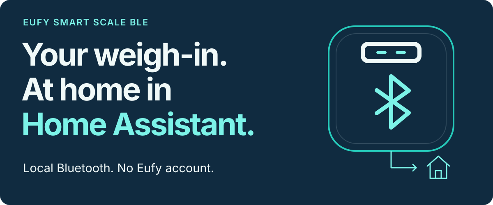

# Eufy Smart Scale BLE

<p>
  
</p>

[](https://github.com/Skriipt/eufy-smart-scale-ble/actions/workflows/tests.yml)
· [HACS custom integration](#installation)
· [Home Assistant 2026.8+](https://www.home-assistant.io/)
· [MIT](LICENSE)

Bring compatible Eufy scale measurements into **Home Assistant over local Bluetooth**.
No Eufy account, cloud API, or vendor credentials required. No YAML setup.

**[Check your model](#compatibility) · [Install](#installation) · [First weigh-in](#first-weigh-in) · [Get help](#troubleshooting)**

## From a weigh-in to useful entities

**Scale → Bluetooth adapter or compatible ESPHome proxy → Home Assistant**

The integration exposes the measurements your model can provide, separates live
readings from completed weigh-ins, and keeps completed measurements available
while the scale sleeps.

| In Home Assistant | What you get |
|---|---|
| **Measurements** | Completed and real-time weight (kg), impedance (Ω), heart rate (bpm), battery (%), and last measurement — depending on your model. |
| **Local estimates** | Experimental body-composition values, calculated from a complete weight-and-impedance pair and your profile. |
| **Diagnostics** | Packet status with parser and measurement-session information. |

Available entities depend on your model and enabled options.
See [measurements and options](#measurements-and-options).

> [!IMPORTANT]
> Requires **Home Assistant 2026.8.0+** and a working Bluetooth adapter or
> compatible ESPHome Bluetooth proxy. **P3/T9150 is hardware-verified by this
> project.** The other seven models use compatible public protocol implementations
> and await project hardware verification.

## Compatibility

Weight support does not imply support for impedance or body composition.
**Verified** means tested on project-owned hardware. **Upstream validated** means
implemented from compatible public sources, without project hardware testing.

| Model | Weight | Other measurements | Body composition |
|---|---|---|---|
| **P3 / T9150** | **Verified** | **Verified impedance, heart rate** | Experimental; enabled by default |
| A1 / T9120 | Upstream validated | Impedance, battery | Experimental opt-in |
| C20 / T9130 | Upstream validated | Impedance, heart rate | Experimental opt-in |
| Smart Scale / T9140 | Upstream validated | Battery; experimental impedance, off by default | Experimental opt-in |
| C1 / T9146 | Upstream validated | Impedance, battery with **Extended metrics** | Experimental opt-in |
| P1 / T9147 | Upstream validated | Impedance, battery with **Extended metrics** | Experimental opt-in |
| P2 / T9148 | Upstream validated | None | Unsupported |
| P2 Pro / T9149 | Upstream validated | Heart rate | Unsupported |

The [full support matrix](docs/support-matrix.md) lists discovery names, transports,
and capability notes. [Protocol sources](docs/protocol-sources.md) documents the
evidence behind non-P3 support. Experimental capabilities require caution or an
explicit opt-in; unsupported capabilities are not exposed.

## Installation

### HACS

Add this integration as a **custom repository** in HACS:

1. Open **HACS → Integrations → menu → Custom repositories**.
2. Add the URL below with **Integration** as the category.
3. Open **Eufy Smart Scale BLE**, select **Download**, and restart Home Assistant.

```text
https://github.com/Skriipt/eufy-smart-scale-ble
```

<details>
<summary>Manual installation</summary>

Copy the entire `custom_components/eufy_smart_scale_ble` directory into your
Home Assistant configuration directory so that this file exists:

```text
/config/custom_components/eufy_smart_scale_ble/manifest.json
```

Restart Home Assistant after copying or replacing the files.

</details>

<details>
<summary>Upgrading from 0.2.x — one-time re-add required</summary>

Version 0.3.0 changed the integration domain from `eufy_p3_ble` to
`eufy_smart_scale_ble`. Home Assistant cannot safely rewrite an existing config
entry to the new domain.

1. Remove the existing **Eufy Smart Scale P3 BLE** config entry.
2. Update through HACS or replace the manually installed files.
3. Delete `/config/custom_components/eufy_p3_ble` if it is still present.
4. Restart Home Assistant and add **Eufy Smart Scale BLE** again.
5. Re-enter any body-composition profile options you used previously.

Entity registry entries may be recreated because the integration domain changed.

</details>

## First weigh-in

1. **Wake the scale** by stepping on it briefly.
2. Open **Settings → Devices & services** and confirm the discovered
   **Eufy Smart Scale BLE** integration.
3. **Complete a weigh-in.** For impedance, stand barefoot on all electrodes until
   the scale finishes its analysis.

If discovery does not appear, choose **Add integration**, search for
**Eufy Smart Scale BLE**, and select a currently discovered scale.

If Home Assistant's official **EufyLife** integration also discovers the same
scale, remove or ignore that entry to avoid duplicate devices and sensors.

## Measurements and options

### Live readings and completed measurements

Live weight changes during a weigh-in. Completed weight updates when the session
finishes. Calculated body-composition values require a final weight and usable
impedance from the **same session**; a weight-only session does not reuse older
impedance, and a partial session leaves previous estimates in place.

<details>
<summary>Session matching and Bluetooth behavior</summary>

Measurement phases and a **30-second window** correlate weight and impedance.
A changed final weight starts a new session without inheriting the preceding
weight's impedance.

Models with sufficient advertisement data are handled passively. Short-lived
GATT connections are used only for models or optional metrics that require them.
Advertisements work through proxies without active connection support; **GATT
requires a connectable adapter or proxy**. Live and status entities follow
Bluetooth availability; completed measurements remain available while the scale
sleeps.

GATT attempts are debounced and setup times out after 30 seconds. Established
connections are scheduled to disconnect within 30 seconds, shortened to at most
5 seconds after a completed measurement. Disconnect cleanup has a separate
5-second timeout. Unloading cancels pending connection work.

P3 parsing filters duplicate and older counters within a running instance.
Other protocol families do not have equally verified ordering or session
identity. Delayed frames, cached manufacturer payloads, or consecutive weigh-ins
without an observed live phase can remain ambiguous. Correlation cannot be
guaranteed for every firmware or packet order; see the
[engineering audit](docs/engineering-audit-2026-10-22.md).

</details>

### Experimental body composition

With a supported model, usable impedance, a completed same-session measurement
pair, and the required profile fields, local calculations can provide BMI, body
fat percentage and mass, lean body mass, muscle mass, bone mass, body water,
basal metabolic rate, visceral fat, protein, skeletal muscle mass, subcutaneous
fat, body age, and body type.

The algorithm is calibrated primarily against **P3/T9150** and is enabled by
default only for that model. Supported cross-model calculations require opt-in.
The latest complete measurement pair is stored locally, so changing your profile
can recalculate estimates without another weigh-in.

> [!WARNING]
> Body-composition values are experimental estimates, not medical measurements.
> Do not use them for diagnosis or medical decisions. P2 and P2 Pro do not expose
> impedance or body composition; their composition field is intentionally kept
> opaque because the evidence does not support interpreting it as impedance.

<details>
<summary>Which options does my model need?</summary>

- **C1/T9146 and P1/T9147:** enable **Extended metrics** for GATT impedance and
  battery. Experimental body composition also requires this option.
- **Smart Scale/T9140:** experimental impedance and body composition are separate
  opt-ins because firmware and characteristic variants exist.
- **A1/T9120 and C20/T9130:** experimental cross-model body composition requires
  explicit opt-in.
- **P2/T9148 and P2 Pro/T9149:** impedance and body composition are unavailable.

</details>

## Privacy and diagnostics

Parsing and body-composition calculations run **locally in Home Assistant**.
The integration does not contact Eufy's cloud or request an account or credentials.
Home Assistant's standard integration diagnostics exclude Bluetooth addresses,
raw packets, measurements, profile fields, and precise measurement timestamps.

**Before opening a public issue, review every attachment for personal data.** Use
standard diagnostics; do not share raw captures, Bluetooth addresses, personal
measurements, profiles, or screenshots containing them.

<details>
<summary>Local storage, retention, and Bluetooth identity</summary>

- Profile data stays in the Home Assistant config entry and is not copied into
  calculated sensor attributes. Measurement values and input timestamps are
  visible in entity state and may be retained by Recorder and backups.
- The latest complete weight-and-impedance pair is stored with owner-only
  permissions and removed when the config entry is deleted. Existing files get
  those permissions on their next write. Historical Recorder data, old profile
  attributes, and backups are not erased by this change.
- Standard diagnostics contain only model, protocol, capability, parser/session,
  and connection metadata.
- Advertisements are checked against the configured address and, when available,
  model name. GATT requires the expected notification characteristic. BLE identity
  is not cryptographically authenticated; a nearby attacker able to spoof these
  properties can still forge plausible data.
- Advanced protocol capture is disabled by default, limited to 100 in-memory
  frames, cleared on reload or restart, and excluded from standard diagnostics.

</details>

## Troubleshooting

<details>
<summary>The scale is not discovered or is missing from manual setup</summary>

Wake it, keep it near a Home Assistant Bluetooth adapter or proxy, and check its
discovery name in the [support matrix](docs/support-matrix.md). Inspect Home
Assistant's Bluetooth diagnostics while the scale is awake. Manual setup lists
only supported scales that are currently discovered.

</details>

<details>
<summary>Weight updates, but body composition is missing or unchanged</summary>

Check that the model supports impedance, enable the required experimental or
extended options, complete the profile, and perform a barefoot measurement that
reaches final impedance. Partial and weight-only sessions leave previous
calculated values in place. For C1/P1 impedance and battery, enable
**Extended metrics**.

</details>

<details>
<summary>Duplicate devices appear, or the integration does not load</summary>

For duplicates, remove or ignore the official EufyLife entry for the same scale.
For loading problems, confirm Home Assistant **2026.8.0+** and check that
`manifest.json` is directly at
`/config/custom_components/eufy_smart_scale_ble/manifest.json`.

</details>

<details>
<summary>Enable debug logging</summary>

Temporarily add this to `configuration.yaml`:

```yaml
logger:
  logs:
    custom_components.eufy_smart_scale_ble: debug
```

Restart Home Assistant, reproduce the problem, and review the log. Remove the
debug configuration afterwards. Review all attachments for personal data before
posting publicly.

</details>

## Help verify a model

Have a scale other than P3? Follow the [privacy-safe verification guide](docs/model-verification.md)
and report which capabilities work through the [issue tracker](https://github.com/Skriipt/eufy-smart-scale-ble/issues).
Reproducible hardware reports help turn upstream support into verified support.

<details>
<summary>Contributing and local development</summary>

```bash
python -m pip install -e '.[test]'
ruff format --check .
ruff check .
mypy
pytest --cov=custom_components/eufy_smart_scale_ble --cov-branch
```

All committed BLE fixtures must be synthetic. Never commit raw captures,
Bluetooth addresses, or personal measurement/profile data.

</details>

---

[Release notes](CHANGELOG.md) · [Protocol sources](docs/protocol-sources.md) · [MIT License](LICENSE)

An independent community project, unaffiliated with Eufy or Anker Innovations.
